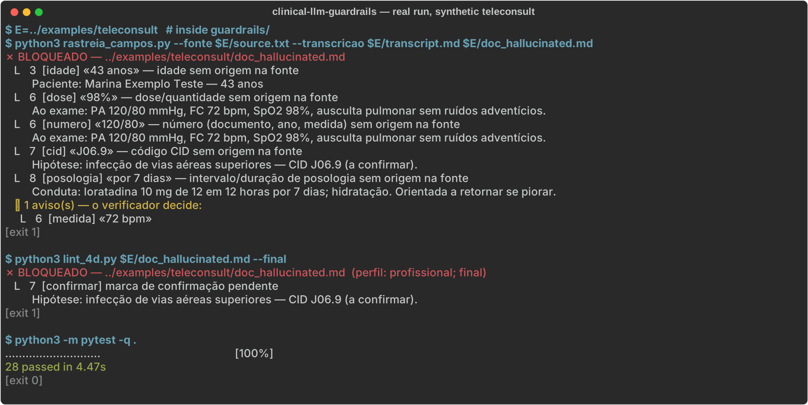

# clinical-llm-guardrails

Deterministic release gate for LLM-drafted clinical documents. Before a referral, report or patient handout leaves the system, two Python checks compare it against what the physician actually said. If the draft contains a number, dose, date, age or ICD code that has no origin in the source, it is not released.

Built and used in daily practice by a primary care physician in Brazil. The documents and the patterns are in Brazilian Portuguese; the code comments and this README are in English.



## The problem

An LLM that drafts a clinical document from a visit note or a transcript produces text that reads well and is wrong in small, specific ways:

- **Findings nobody measured.** A teleconsult summary comes back with "BP 120/80 mmHg, SpO2 98%", although no one examined the patient.
- **Silent edits.** 25 mg becomes 5 mg, "every 8 hours for 7 days" becomes "every 12 hours for 10 days", a 34-year-old becomes 43.
- **Filled gaps.** A birth year, a city or an ICD code appears that the physician never gave.
- **Doubt on paper.** The draft that goes to a colleague, a school or a court still says "(to confirm)" or `[specialty]`.

A second LLM pass catches some of this, some of the time. A reviewer who is told "the model checked it" catches less.

## The approach

The full system is a hybrid:

1. **An agent skill** (private; it holds the clinical content) tells the model how to reason, what to ask the physician before writing, and how to mark where each statement came from.
2. **A deterministic layer** (this repository) runs after the draft exists and before anything is delivered. It does not use a model, so it cannot be talked out of a finding.

The deterministic layer is two scripts:

| Script | Question it answers | Blocks on |
|---|---|---|
| `rastreia_campos.py` (field tracer) | Does every concrete datum in the document exist in the source? | Identification fields, dates, numbers of 3+ digits, doses with units, dosing intervals and durations, ages, time since onset, ICD codes, regulation numbers with no origin |
| `lint_4d.py` (document linter) | Is this document finished? | Doubt markers, unfilled placeholders, blank identifiers and dates; with `--final`, missing mandatory pieces (signature, footers, patient-agreement block for legal documents) |

The **source** is the physician's messages copied verbatim, plus attachments by file path (PDF, DOCX, text). A visit **transcript** is a weaker source: it can support a dose or a date, but not an identification field. A name heard in a recording does not become the patient's name on a document.

## Run the demo

```bash
pip install -r requirements.txt
./demo.sh                    # two summaries of the same teleconsult
python3 -m pytest -q guardrails
```

`examples/teleconsult/` holds a synthetic case: the physician's note, the transcript, a faithful summary and a summary with planted errors.

What the gate caught in the bad summary:

| Line in the draft | Finding |
|---|---|
| `43 anos` | Age not in the source (source says 34) |
| `PA 120/80 mmHg`, `SpO2 98%` | Vital signs with no origin: the visit was remote and no exam was done |
| `CID J06.9` | ICD code nobody gave |
| `por 7 dias` | Duration never prescribed (source says 5 days) |
| `(a confirmar)` | Doubt marker left in a document addressed to a colleague |

What it did **not** catch, and why:

- `há 10 dias` (source: 5 days) passed, because `10` exists in the source as "10 mg". Same for `de 12 em 12 horas`, because `12` exists in the date. The tracer proves that a number exists in the source, not that it belongs to that fact.
- `ausculta pulmonar sem ruídos adventícios` (normal lung sounds) passed. A qualitative finding has no token to trace.

Both gaps are declared in the code and pinned by tests (`test_limite_declarado_valor_nao_e_ligado_ao_item`, `test_declared_limit_is_visible_in_the_demo`). In the full system they are covered by the skill's rules (a remote visit is written as "physical exam: not performed") and by a separate verifier pass that binds each value to its item. That part is model-based and is not in this repository.

## Design decisions

- **Fail closed.** An empty file, a scanned PDF with no text layer or a corrupted extraction returns exit code 2 (`ILEGÍVEL`), never "clean". A check that did not run is reported as not run.
- **Tokens, not substrings.** "5 mg" does not pass because the source contains "25 mg"; "1958" does not pass because the source contains "219, 58 kg". Numbers inside names (GAD-7, B12, SpO2) are not values and cannot justify "7 days".
- **Three outcomes, not two.** Besides pass and block, the linter has `PERGUNTAR` (ask, exit code 3) for wording only the physician can judge, such as "probably" in a report. The tool stops and asks; it never rewrites on its own.
- **Calibrated on real documents.** The first version blocked ordinary prose. `fixtures/real_false_positives.md` keeps sentences from real documents that look like markers and are not (a verb in prose, a diary line for the patient to fill in, a colleague's "Dr."). They must keep passing.
- **Identity in one file.** `config_autor.py` holds the author's name, licence number and local network. Nothing else in the code knows who the physician is.

## Tests

28 tests, all runnable offline:

- `test_rastreia_v2.py`: tampered doses, dates, ages and dosing must block; faithful documents must pass, including shorthand ("amoxi 500mg 8/8h 7d"), numbers written out and ISO dates in attachments.
- `test_lint_v2.py`: every marker and placeholder form, the three document profiles, mandatory pieces with `--final`.
- `test_examples.py`: the demo above.

## Scope and limits

- Brazilian Portuguese only. The regular expressions encode pt-BR number formats, units and phrasing.
- It checks traceability and completeness. It does not check clinical correctness, guideline adherence or formulary coverage.
- It is a gate in front of a physician who reads and signs every document. It is not a medical device and does not replace that review.
- All names in tests, fixtures and examples are synthetic. No patient data is in this repository.

## Author

Felipe Ribeiro Toledo, physician (CRM-SP 216.986), primary care, São Paulo state, Brazil.
